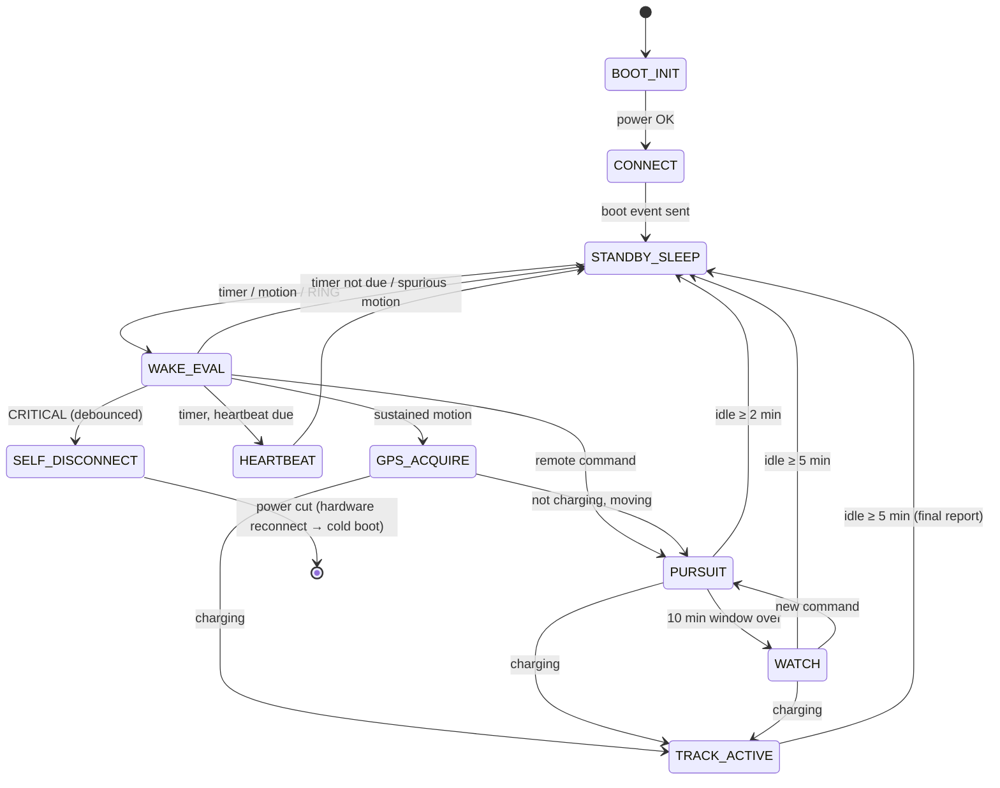

# GPS Tracker Firmware — Architecture (draft v0)

Status: **draft for review**. Nothing here is implemented yet.

Sources, in priority order:

1. `../gps_tracker_backend/PROTOCOL.md` (protocol v1): the contract with the backend. Wins every conflict.
2. `Wake-on-Motion Lifecycle.md`: power and state behaviour. It applies wherever it doesn't contradict (1).

Target: LilyGO T-Call A7670 V1.0 (ESP32-D0WD-V3 + 4 MB PSRAM, A7670E-FASE LTE Cat-1), Arduino on PlatformIO.

---

## 1. Goals that shape the design

| Goal | Consequence |
|---|---|
| Easy to debug | Single-threaded, explicit state machine. Every transition is logged with its reason. No hidden FreeRTOS tasks share state. |
| Easy to test | Decisions (state machine, power tiers, motion debounce, batching, JSON) are pure C++ with no Arduino headers, so they run under `pio test -e native` on the laptop. |
| Swappable hardware | The GNSS source, accelerometer, bus-voltage sensing and load switch are not on the board yet. Each one sits behind a small interface with a "none/fake" implementation, so the bench board runs today. |
| Never send invalid data | The backend replies with nothing but PUBACK. The firmware therefore validates locally: clock set, fix valid, not `0,0`, 1–100 fixes, `v:1`. |
| Never lose fixes | Fixes go into an outbox and leave it only on PUBACK. The outbox survives deep sleep, and reboot too where it's cheap. |

---

## 2. Layered module map

```
┌───────────────────────────────────────────────────────────────────────┐
│ app/            Lifecycle (state machine runner) · main.cpp wiring    │
├───────────────────────────────────────────────────────────────────────┤
│ core/  (pure)   LifecyclePolicy · PowerPolicy · MotionFilter          │
│                 FixOutbox · BatchPlanner · ProtocolEncoder            │
│                 CommandParser · ClockMath · Config                    │
├───────────────────────────────────────────────────────────────────────┤
│ services/       Uplink · MqttSession · NetworkLink · ClockService     │
│                 PositionService · CommandService                      │
├───────────────────────────────────────────────────────────────────────┤
│ drivers/        A7670Modem (AT owner) · GnssSource (modem / NMEA)     │
│                 MotionSensor (accel / none) · BusVoltage (ADC / fake) │
│                 LoadSwitch (gpio / none)                              │
├───────────────────────────────────────────────────────────────────────┤
│ platform/       Board pins · Sleep/Wake · RtcStore · NvsStore · Log   │
└───────────────────────────────────────────────────────────────────────┘
```

Dependency rule: a layer calls only the layers **below** it. `core/` depends on nothing, not even Arduino. Services and drivers are reached through interfaces that `main.cpp` wires together, so tests can substitute fakes.

### 2.1 platform/

| Module | Responsibility |
|---|---|
| `Board` | Pins and levels, wrapping `utilities.h` (the only file that includes it). Modem power-key/reset pulse sequences. |
| `Sleep` | Enter deep or light sleep. Arm the wake sources: RTC timer, ext0 on `MODEM_RING_PIN` (GPIO13), ext1 on the accelerometer IRQ. Report the wake cause. Hold the DTR level across sleep with `gpio_hold_en`. |
| `RtcStore` | One `RTC_DATA_ATTR` struct with a magic number, version and CRC. Survives deep sleep, lost on power loss. |
| `NvsStore` | ESP32 NVS (`Preferences`) for rarely-written data: config overrides, `last_state`, last fix, `disconnect_time`. NVS is wear-levelled, but still keep writes infrequent. |
| `Log` | `LOGI(tag, fmt, ...)` with levels and a compile-time filter. One tag per module (`MODEM`, `MQTT`, `LIFE`, …). It never prints key material, and `DUMP_AT_COMMANDS` stays opt-in. |

### 2.2 drivers/

| Module | Responsibility |
|---|---|
| `A7670Modem` | **Sole owner of `SerialAT`.** Wraps TinyGSM for power on/off, SIM, registration, RSSI, `AT+CCLK`, DTR sleep (`AT+CSCLK=1`) and certificate upload. Runs a URC dispatcher so asynchronous lines (`+CMQTTPUB:`, `+CMQTTRXSTART…`, `+CMQTTCONNLOST:`, `RING`) reach their subscribers and aren't swallowed. |
| `GnssSource` (interface) | `powerOn(hot)`, `powerOff(keepBackup)`, `poll() -> optional<Fix>`. The implementation is **`ModemGnss`**, using the A7670E-FASE's built-in GNSS through the shared AT channel: `AT+CGNSSPWR`, `AT+CGNSSMODE` and `AT+CGNSSINFO`. Not `AT+CGPS`, which is a SIM7600 command and returns `ERROR` on the A7670. An **active** GNSS antenna is required on the modem's GNSS IPEX connector. The interface stays in place so a future board can use an external module. |
| `MotionSensor` (interface) | `arm(thresholdMg)`, `irqPin()`, `sampleMagnitudeMg()`. **v1 uses only `NoMotionSensor`**, which reports "always moving" so the device tracks continuously. A real accelerometer arrives in the next hardware version (see README). |
| `BusVoltage` (interface) | `readVolts()`. `AdcBusVoltage` reads a resistor divider on an ADC1 pin (ADC2 is unusable while the radio is active); README → Hardware roadmap has the recommended divider. `FixedBusVoltage` is for the bench. |
| `LoadSwitch` (interface) | `cutSelf()`: opens the MOSFET and the MCU dies. `NoLoadSwitch` logs the call and deep-sleeps forever instead. |

### 2.3 services/ (stateful, built from drivers)

| Module | Responsibility |
|---|---|
| `NetworkLink` | Registration and PDP context, with retry and backoff. Exposes `isUp()` and `rssiDbm()`. |
| `MqttSession` | **Our own thin layer over `AT+CMQTT*`**. TinyGSM's `mqtt_publish()` returns on `OK`, which only means the modem queued the publish. PUBACK arrives later as the `+CMQTTPUB: <idx>,0` URC, and `MqttSession` waits for that URC before reporting a publish as delivered. It also handles TLS setup, CONNECT with client ID = thing name, SUBSCRIBE to `cmd` (QoS 1), connection-lost URCs and reconnects. API: `publish(topic, payload, timeout) -> Delivered / Failed / LinkLost`. |
| `ClockService` | Keeps UTC epoch milliseconds. Source order: GNSS time > network time (`AT+CCLK`, NITZ) > none. It anchors `millis()` to the last good sync and carries the anchor across deep sleep via RTC memory plus the sleep duration. `isSet()` applies the protocol's rule (≥ 2020-01-01). **No publish happens while `!isSet()`.** |
| `PositionService` | Drives the `GnssSource` per mode (hot/cold budget, continuous NAV, backup between fixes) and rejects invalid fixes (no lock, `0,0`, out of range, timestamp before the clock was set). It also feeds GNSS time into `ClockService`. |
| `Uplink` | Takes batches from `FixOutbox` through `BatchPlanner`, encodes them with `ProtocolEncoder`, publishes via `MqttSession`, and acks the outbox **only** on `Delivered`. It also sends `status` events. Owns `seq`. |
| `CommandService` | Turns commands from two sources into `LifecycleEvent`s (`PursuitRequested`, `ConfigChanged`). The sources are the **MQTT `cmd` topic** while connected (dedupe on `commandId`) and **SMS / voice call** while parked (§4.1). Unknown commands are ignored, as the protocol requires. |

### 2.4 core/ (pure logic, unit-tested natively)

| Module | Responsibility |
|---|---|
| `Config` | All tunables in one struct. Compile-time defaults, overridable from NVS, and from `set_interval` later. See §6. |
| `PowerPolicy` | Volts → tier `OK / LOW / CRITICAL`, with hysteresis (OK↔LOW at 12.0 V falling / 12.2 V rising), crank debounce (CRITICAL only if low for > 2 s) and charging detection (≥ 13.2 V). |
| `MotionFilter` | Debounce: sustained ≥ 0.3 g for ≥ 200 ms counts as motion. Idle timers (idle ≥ 2 min, idle ≥ 5 min). |
| `LifecyclePolicy` | **The state machine as a pure function**: `next(state, inputs) -> {state, actions[], reason}`. The inputs are a snapshot (tier, charging, moving, idleFor, fixValid, timers, pendingCommand). Every row of the lifecycle rule table becomes a unit test. |
| `FixOutbox` | A ring buffer of compact fixes (~20 B each: ts ms, lat/lon int32 1e-7°, alt dm, spd, crs, sat, hdop). Uses `peekOldest(n)`, then `ack(n)` or no-op on failure, so nothing is lost before PUBACK. When full it drops the oldest and counts the drops. |
| `BatchPlanner` | Decides when to publish (publish interval elapsed, ≥ N fixes queued, final report, backlog drain) and how many fixes go in a message (≤ 100, payload ≤ the modem's 10 KB `CMQTTPAYLOAD` limit). |
| `ProtocolEncoder` | Builds the `telemetry` / `status` JSON into a caller-supplied buffer with `snprintf`, with no heap and no ArduinoJson needed. It omits absent optional fields (never `null`) and emits 6-decimal lat/lon. |
| `CommandParser` | Minimal JSON reader for the reserved `cmd` shape: `v`, `commandId`, `command`, `arguments`. |

### 2.5 app/

| Module | Responsibility |
|---|---|
| `Lifecycle` | The runner. Each iteration it collects inputs from the services, calls `LifecyclePolicy::next`, executes the returned actions, logs `LIFE: TRACK_ACTIVE -> PURSUIT (reason: not charging, moving)`, and persists the state that needs persisting. |
| `main.cpp` | Wiring only: builds the concrete drivers for this board, injects them, runs `Lifecycle`. Roughly 50 lines. |

---

## 3. Concurrency model

**One cooperative super-loop.** No application FreeRTOS tasks.

- The AT channel is a single serial pipe, so a single owner (`A7670Modem`) removes a whole class of interleaving bugs.
- Each service exposes `tick(nowMs)`. Blocking calls (TinyGSM waits, `CMQTTPUB` → PUBACK) always take explicit timeouts no longer than the 30 s watchdog.
- URCs are drained in `A7670Modem::tick()` and also inside every wait loop, then dispatched to their subscribers. This is how PUBACK and `cmd` messages arrive.
- Task watchdog enabled. A hang means a reset, and the reset reason is logged in the next `boot` event.

If this later proves too slow (for example, GNSS NMEA overflowing during a long TLS handshake), the escape hatch is a single dedicated UART-reader task feeding a queue. The rest stays the same.

---

## 4. Lifecycle state machine

States follow the lifecycle doc. Each one is a value of `enum class State`.



What each state means for the drivers:

| State | MCU | GNSS | Modem | Sample / publish |
|---|---|---|---|---|
| STANDBY_SLEEP | deep sleep | off (modem GNSS keeps no backup domain) | DTR sleep (`AT+CSCLK=1`), registered, no data session; RING wakes it | — |
| WAKE_EVAL | awake < 50 ms | unchanged | unchanged | — |
| HEARTBEAT | awake | hot start ≤ 10 s | wake, publish, sleep | `status: heartbeat` (+ 1-fix telemetry if a fix was obtained) |
| GPS_ACQUIRE | awake | hot ≤ 8 s / cold ≤ 45 s | idle | — |
| TRACK_ACTIVE | awake | NAV | connected | 10 s / 60 s (OK), 10 s / 180 s (LOW) |
| PURSUIT | awake | NAV | connected | 5 s / 15 s, tier ignored |
| WATCH | light sleep between | fix, then backup | connected or DTR-sleep | 1 fix / 4 min |
| SELF_DISCONNECT | off | off | off | `low_battery` then `shutdown` if link up |

Any delivered report (telemetry or status) resets `last_report_time`, which drives the heartbeat-due check.

### 4.1 Remote wake: SMS or RING

While parked, the modem stays registered on the network in DTR sleep with no data session and no MQTT connection. An incoming SMS or call pulls `MODEM_RING_PIN` (GPIO13, an RTC GPIO) low, and that wakes the ESP32 through `ext0`.

| Trigger | Check | Action |
|---|---|---|
| Voice call | Caller ID (`+CLIP`) is on the allowlist | Reject the call (no charge), then `PURSUIT_START` |
| SMS `TRACK <pin>` | Sender is on the allowlist **and** the PIN matches | Delete the SMS, then `PURSUIT_START` |
| SMS `STOP <pin>` | same | End PURSUIT/WATCH, then `STANDBY_SLEEP` |
| Anything else | — | Delete it, log it, go back to sleep. A RING with nothing to read counts as spurious. |

SMS sender IDs can be spoofed, so the allowlist alone isn't enough; the PIN is required too. The allowlist and PIN are stored in NVS and set at provisioning. After `PURSUIT_START` the device connects MQTT as usual, so the backend sees the pursuit through normal telemetry. Nothing in protocol v1 changes.

On every wake, before sleeping again, the firmware reads and deletes any stored SMS (`AT+CMGL`). This way a RING lost during a busy period isn't missed for good.

---

## 5. Data flow: one fix from GNSS to DynamoDB

```
GnssSource.poll() ─► PositionService (validate, stamp ts) ─► FixOutbox.push()
                                                                │
BatchPlanner.shouldPublish(now) ──yes──► FixOutbox.peekOldest(≤100)
                                                                │
                     ProtocolEncoder.telemetry(seq, fixes, batV, rssi) ─► buffer
                                                                │
                     MqttSession.publish("trackers/<id>/telemetry", buffer)
                                  │                    │
                             Delivered            Failed / LinkLost
                                  │                    │
                       FixOutbox.ack(n), seq++     keep, retry after reconnect
```

Resending the same fixes is safe: the backend keys on `(device, fix ts)`.

---

## 6. Configuration and secrets

- **Device identity and endpoint** come from a gitignored `secrets.ini`, included by `platformio.ini` via `extra_configs`. It provides `-DDEVICE_ID=\"kawasaki-z400\"` and `-DMQTT_HOST=\"…-ats.iot.ap-southeast-2.amazonaws.com\"`.
- **Certificates** stay out of the firmware image and the repo. A one-off `provision` build env, or a serial command, uploads `AmazonRootCA1.pem`, `device.pem.crt` and `private.pem.key` into the A7670's own filesystem with `AT+CCERTDOWN`. The normal firmware references them by file name only, and checks `AT+CCERTLIST` at boot. If they're missing, it logs an error and doesn't connect. The key never passes through the log.
- **Tunables** (`Config`): sample and publish intervals per state, heartbeat period, voltage thresholds, idle timeouts, GNSS budgets and pursuit window. They are compile-time defaults, NVS can override them, and `set_interval` will later map onto them.

---

## 7. Time representation

| Where | Unit | Type | Why |
|---|---|---|---|
| On the wire (`ts`, `fixes[].ts`) | **milliseconds** | JSON integer | The protocol requires it. |
| In memory (`ClockService::nowMs()`) | milliseconds | `int64_t` | Matches the wire, so the encoder can't make a ×1000 mistake. |
| Stored fixes (`FixOutbox`), RTC/NVS timestamps | **seconds** | `uint32_t` | Half the size of `int64`. It's enough because fixes are ≥ 5 s apart and GNSS reports whole seconds. `uint32` lasts until 2106. |
| Intervals and timeouts | milliseconds | `uint32_t` of `millis()` | Monotonic; never wall-clock. Compare with `now - start >= dur` so wrap-around is safe. |

Conversions happen in one place, `ClockMath` (`toWireMs(uint32 s)`, `toStoreS(int64 ms)`), and are unit-tested.

## 8. Persistence plan

**Correction to the lifecycle doc:** ESP32 deep sleep does **not** keep RAM or PSRAM. Only the 8 KB of RTC slow memory survives. Light sleep keeps RAM, but costs about 0.8 mA versus about 10 µA.

| Data | Where | Survives |
|---|---|---|
| `FixOutbox` (≈ 250 × 20 B) | RTC memory | deep sleep. PSRAM extends it while awake for long offline stretches. |
| Outbox snapshot | NVS, written only before a planned shutdown or `SELF_DISCONNECT` | power loss |
| Clock anchor, `seq`, `pursuit_window_end`, `last_command_id`, motion debounce, current state | RTC memory | deep sleep |
| `last_state`, last fix, `last_report_time`, `disconnect_time` | NVS (written on change, rate-limited) | power loss |
| `battery_tier` | RTC memory (recomputed every wake anyway) | deep sleep |

---

## 9. Where the two documents disagree, and the resolution

| Topic | Protocol | Lifecycle doc | Resolution |
|---|---|---|---|
| Heartbeat interval | 15 min while stationary | 6 h (OK) / 12 h (LOW) | Default **15 min** (protocol). `Config.heartbeatS` makes it tunable. Each heartbeat means a modem wake plus a TLS handshake. Moving to 6 h / 12 h is in README → Future improvements. |
| Status events | `boot`, `heartbeat`, `low_battery`, `shutdown` only | reconnect alert, "no fix" heartbeat | Reconnect after disconnect → `boot` with extra optional fields `downtimeS` and `lastFixTs` (the backend ignores unknown fields). "No fix" → a plain `heartbeat`. Last position → telemetry only when the fix is fresh. |
| Remote "track me" channel | MQTT `cmd` topic (reserved) | modem RING / SMS | Both. SMS or a call wakes the parked device (§4.1). `cmd` over MQTT is honoured while connected. |
| Timestamps | epoch ms | unix seconds | ms on the wire and in memory, seconds in storage (§7). |
| Offline buffer | RAM / PSRAM | ring buffer that survives hibernate | RTC memory + PSRAM, with an NVS snapshot before planned power-off (§8). |
| Moving cadence | sample 10 s / publish 60 s | report every 30–60 s (OK), 10–15 s (pursuit) | Sample and publish are separate knobs per state (§4 table). |

---

## 10. Proposed source tree

```
include/utilities.h          (LilyGO pin map, unchanged; included only by platform/Board)
lib/core/                    pure C++17, no Arduino; built for both esp32 and native
  Config.h  PowerPolicy.*  MotionFilter.*  LifecyclePolicy.*
  FixOutbox.*  BatchPlanner.*  ProtocolEncoder.*  CommandParser.*  ClockMath.*  Types.h
src/
  main.cpp
  app/Lifecycle.*
  services/NetworkLink.*  MqttSession.*  ClockService.*  PositionService.*  Uplink.*  CommandService.*
  drivers/A7670Modem.*  gnss/{GnssSource.h, ModemGnss.*}
          motion/{MotionSensor.h, NoMotionSensor.*}  power/{BusVoltage.h, LoadSwitch.h, …}
  platform/Board.*  Sleep.*  RtcStore.*  NvsStore.*  Log.*
test/
  test_power_policy/  test_lifecycle_policy/  test_fix_outbox/
  test_batch_planner/ test_protocol_encoder/  test_command_parser/
platformio.ini               + [env:native] for unit tests, + [env:provision]
secrets.ini                  (gitignored)
```

---

## 11. Delivery phases

The hardware the lifecycle doc assumes doesn't exist on the bench yet (accelerometer, bus divider, load switch, motorcycle). This firmware version runs without an accelerometer: wake sources are the timer and SMS/RING only, and the device tracks whenever it's awake. Each phase ends with something that runs and can be checked against the backend.

| Phase | Scope | Done when |
|---|---|---|
| **P1: connected tracker** | platform, `A7670Modem`, `NetworkLink`, `MqttSession` (with PUBACK), `ClockService`, `ProtocolEncoder`, `Uplink`, plus a `boot` event | A `boot` message lands in DynamoDB |
| **P2: always-on tracking** | `GnssSource`, `PositionService`, `FixOutbox`, `BatchPlanner`, store-and-forward, `heartbeat`, `cmd` subscribe | Fixes arrive every 60 s. Pulling the antenna, then reconnecting, backfills the gap. |
| **P3: sleep lifecycle** | `LifecyclePolicy`, deep sleep, RTC persistence, 15-min timer heartbeat, modem DTR sleep | Bench current is measured per state and the state transitions are logged |
| **P4: remote wake & pursuit** | RING → `ext0` wake, SMS/call parsing with allowlist + PIN, `CommandService` → PURSUIT / WATCH | An SMS `TRACK <pin>` to the sleeping device produces 15 s telemetry |
| **P5: power protection** (needs the voltage hardware) | `AdcBusVoltage`, `PowerPolicy`, `low_battery` / `shutdown`, `LoadSwitch`, reconnect `boot` | Driving a variable bench supply through 12.0 / 11.5 / 12.2 V produces the expected transitions |
| **Next HW version** | Real `MotionSensor`, motion-gated GPS_ACQUIRE, idle timers driven by motion | See README → Hardware roadmap |

---

## 12. Decisions log

| # | Question | Decision (2026-10-21) |
|---|---|---|
| D1 | GNSS source | The A7670E-FASE's built-in GNSS, through AT commands. No external module. |
| D2 | Heartbeat period | 15 min for now, per the protocol. 6 h / 12 h is a future improvement. |
| D3 | Accelerometer | Not in this firmware version. `NoMotionSensor` is used, and the real sensor comes in the next hardware version. |
| D4 | Remote wake while parked | SMS or voice call (RING pin), not MQTT keepalive. |
| D5 | Time units | Milliseconds on the wire and in memory, seconds in storage (§7). |
